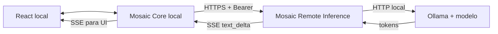

<!-- Mosaic visual identity: graphite, white and red #E3262E. -->
<div align="center">
  
  <h1>MOSAIC · REMOTE INFERENCE</h1>
  <p><strong>Modelos maiores. Um Core que continua sendo seu.</strong></p>
  <p>Serviço HTTP independente para inferência em modelos Ollama hospedados em outra máquina.</p>
</div>

---

## Objetivo

O **Mosaic Remote Inference** recebe pedidos de inferência autenticados, encaminha-os ao Ollama e retorna respostas completas ou fragmentos de texto por Server-Sent Events (SSE). O Mosaic Core local continua dono das conversas, memória, projetos, contexto, tarefas, ferramentas e estado.

## Arquitetura



O token só existe no backend local e no serviço remoto; nunca é enviado ao React.

## Contrato HTTP

| Método | Endpoint | Auth | Retorno |
|---|---|---|---|
| GET | `/health/live` | Não | Processo ativo |
| GET | `/health/ready` | Não | Runtime/modelo disponível |
| GET | `/v1/capabilities` | Não | Capacidades, incluindo `streaming` |
| POST | `/v1/inference` | Bearer | JSON com `model` e `output_text` completos |
| POST | `/v1/inference/stream` | Bearer | SSE com eventos `text_delta` e `data: [DONE]` |

Formato SSE de fragmentos:

```text
data: {"type":"text_delta","text":"Olá"}

data: {"type":"text_delta","text":" mundo"}

data: [DONE]
```

Falha depois de iniciar o streaming é enviada como evento SSE `error`. O cliente não deve considerar a resposta completa se receber esse evento ou se a conexão encerrar antes do marcador terminal.

## Instalação local

Python 3.11+, Git e Ollama.

```bash
git clone https://github.com/IGOR-SciDATA/mosaic-remote-inference.git
cd mosaic-remote-inference
python -m venv .venv
```

Ative o ambiente virtual, depois:

```bash
pip install -r requirements.txt
ollama pull qwen2.5:3b
```

Configure as variáveis de ambiente (não coloque o token em Git ou no frontend):

```dotenv
MOSAIC_REMOTE_INFERENCE_TOKEN=use-um-segredo-aleatorio-longo
MOSAIC_RUNTIME_BASE_URL=http://127.0.0.1:11434
MOSAIC_RUNTIME_MODEL=qwen2.5:3b
MOSAIC_INFERENCE_TIMEOUT_SECONDS=90
MOSAIC_MAX_INPUT_CHARS=24000
MOSAIC_MAX_MESSAGES=40
```

O serviço não carrega automaticamente o arquivo `.env` nesta versão; exporte as variáveis para o processo.

```bash
uvicorn app.main:app --host 127.0.0.1 --port 8090
```

## Testes

```bash
python -m pytest -q
```

Os testes de streaming usam um adaptador fake, sem exigir Ollama. Faça também um teste de fumaça com o modelo e a máquina reais antes de usar o serviço.

## Ligação ao Mosaic local

No ambiente do backend do Mosaic, defina `MOSAIC_REMOTE_INFERENCE_TOKEN` com o mesmo segredo do serviço remoto. Configure o endereço HTTPS do serviço remoto em Configurações de inferência remota. Cadastre um modelo com `provider=remote_inference` e `model_name` igual ao identificador configurado no servidor. O provider deve ser escolhido explicitamente; não há fallback silencioso.

## Execução em Colab e túnel

A aplicação não depende de Colab nem de Cloudflare. Em um ambiente de notebook, use somente a configuração de execução, rede e túnel permitida pelo ambiente e pela conta. Não inclua tokens reais em células versionadas ou logs. O runtime é efêmero: a URL pode deixar de responder quando a sessão terminar. Para uma implantação persistente, use uma máquina de inferência que permita explicitamente servir esse endpoint.

## Limites atuais

- Um modelo configurado por processo.
- Texto apenas; não expõe chamadas de ferramentas remotas.
- Não persiste conversas, memória, tarefas ou resultados.
- A autenticação Bearer é um controle de protótipo, não identidade de produção.
- Testes de contrato não comprovam por si só a integração E2E com GPU/Ollama reais.
