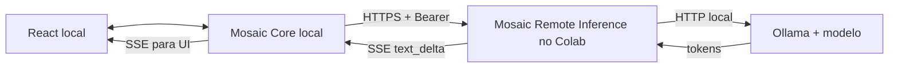

<!-- Mosaic visual identity: graphite, white and red #E3262E. -->
<div align="center">
  
  <h1>MOSAIC · REMOTE INFERENCE</h1>
  <p><strong>Modelos maiores. Um Core que continua sendo seu.</strong></p>
  <p>Serviço HTTP independente para inferência em modelos Ollama hospedados em outra máquina.</p>
</div>

---

## Objetivo

O **Mosaic Remote Inference** recebe pedidos de inferência autenticados, encaminha-os ao Ollama e retorna respostas completas ou fragmentos de texto por Server-Sent Events (SSE). O Mosaic Core local continua dono das conversas, memória, projetos, contexto, tarefas, ferramentas e estado.

## Arquitetura



O token só existe no backend local e no serviço remoto; nunca é enviado ao React. O notebook e o serviço remoto não armazenam histórico do Mosaic.

## Contrato HTTP

| Método | Endpoint | Auth | Retorno |
|---|---|---|---|
| GET | `/health/live` | Não | Processo ativo |
| GET | `/health/ready` | Não | Runtime/modelo disponível |
| GET | `/v1/capabilities` | Não | Capacidades, incluindo `streaming` |
| POST | `/v1/inference` | Bearer | JSON com `model` e `output_text` completos |
| POST | `/v1/inference/stream` | Bearer | SSE com eventos `text_delta` e `data: [DONE]` |

Formato SSE de fragmentos:

```text
data: {"type":"text_delta","text":"Olá"}

data: {"type":"text_delta","text":" mundo"}

data: [DONE]
```

Falha depois de iniciar o streaming é enviada como evento SSE `error`. O cliente não deve considerar a resposta completa se receber esse evento ou se a conexão encerrar antes do marcador terminal.

---

# Tutorial completo: Google Colab + Ollama + Cloudflare Tunnel + Mosaic local

Este tutorial parte do zero. A configuração pressupõe um ambiente em que você tem autorização para executar e conectar esse serviço remoto. O Colab é efêmero: quando a sessão termina, Ollama, a API e o túnel param. Não use este fluxo para manter uma sessão artificialmente ativa ou contornar restrições do ambiente.

## O que você vai montar

- **Google Colab:** executa o Ollama, baixa o modelo e roda a API FastAPI.
- **Cloudflare Named Tunnel:** encaminha um hostname HTTPS seu para a API local do Colab na porta `8090`.
- **Mosaic no seu computador:** envia contexto ao provider remoto e recebe a resposta via SSE. A memória e o histórico continuam locais.

## Antes de começar

Você precisa de:

1. Uma conta Google e um notebook Colab com runtime compatível com o modelo escolhido.
2. Uma conta Cloudflare com um domínio gerenciado pela Cloudflare e permissão para criar um **Named Tunnel** e configurar um hostname público.
3. O Mosaic Core instalado e funcionando localmente.
4. Um token aleatório forte para autenticar o Mosaic com o Remote Inference.
5. Modelo com tamanho compatível com a RAM/VRAM disponível. Este tutorial usa `qwen2.5:3b` como exemplo; você pode escolher outro modelo que rode no runtime.

> **Importante:** Quick Tunnels não são indicados para este fluxo SSE. Use um Named Tunnel com hostname e configuração estáveis durante o experimento. O hostname e o túnel precisam estar autorizados e configurados na sua conta Cloudflare antes da célula de conexão ser executada.

## Parte 1 — Criar o Named Tunnel na Cloudflare

Faça esta parte antes de iniciar o túnel no Colab.

1. Entre no painel Cloudflare Zero Trust.
2. Abra **Networks → Tunnels** (a navegação pode variar conforme a versão do painel).
3. Crie um novo **Cloudflared tunnel** e escolha um nome, por exemplo `mosaic-colab`.
4. Na configuração do túnel, adicione uma **Public Hostname**:
   - **Subdomain:** por exemplo `mosaic-ai`
   - **Domain:** escolha seu domínio configurado na Cloudflare
   - **Service type:** HTTP
   - **URL:** `localhost:8090`
5. Salve a rota e obtenha o token de execução do Named Tunnel conforme as instruções apresentadas pela Cloudflare.
6. Anote o hostname HTTPS completo, por exemplo `https://mosaic-ai.seudominio.com`. O exemplo é ilustrativo; substitua pelo hostname real que você configurou.

Guarde o token do túnel em segredo. Ele é diferente do token `MOSAIC_REMOTE_INFERENCE_TOKEN` da API.

## Parte 2 — Abrir o Colab e clonar o repositório

1. Abra [Google Colab](https://colab.research.google.com/).
2. Crie um notebook novo.
3. Selecione um tipo de runtime com os recursos disponíveis para o seu modelo.
4. Execute a célula abaixo para instalar Ollama e Cloudflared:

```bash
!curl -fsSL https://ollama.com/install.sh | sh
!wget -q https://github.com/cloudflare/cloudflared/releases/latest/download/cloudflared-linux-amd64.deb -O /tmp/cloudflared.deb
!dpkg -i /tmp/cloudflared.deb
```

Inicie o Ollama em uma célula Python:

```python
import os
import subprocess
import time
import urllib.request

ollama_log = open("/tmp/ollama.log", "w")
ollama_proc = subprocess.Popen(
    ["ollama", "serve"],
    stdout=ollama_log,
    stderr=subprocess.STDOUT,
)

for _ in range(60):
    try:
        with urllib.request.urlopen("http://127.0.0.1:11434/api/tags", timeout=2):
            print("Ollama está disponível.")
        break
    except Exception:
        time.sleep(2)
else:
    raise RuntimeError("Ollama não iniciou. Consulte /tmp/ollama.log.")
```

Clone o repositório na branch com streaming:

```bash
!git clone --depth 1 --branch feature/sse-streaming https://github.com/IGOR-SciDATA/mosaic-remote-inference.git /content/mosaic-remote-inference
%cd /content/mosaic-remote-inference
!pip install -r requirements.txt
```

> A branch `feature/sse-streaming` é a branch de desenvolvimento da PR de streaming. Se a mudança já tiver sido integrada em `main`, você pode clonar `main` em vez dela.

## Parte 3 — Baixar o modelo

Escolha um modelo adequado ao runtime. Exemplo:

```bash
!ollama pull qwen2.5:3b
!ollama list
```

Defina o mesmo identificador exibido pelo comando `ollama list` na variável `MOSAIC_RUNTIME_MODEL`. O nome do modelo configurado no servidor é autoritativo: o cliente Mosaic não escolhe nem baixa modelos arbitrariamente.

## Parte 4 — Configurar os segredos e iniciar a API remota

Não escreva tokens em células de texto, não os imprima e não salve valores reais no notebook. Use entrada oculta:

```python
import getpass
import os

REMOTE_TOKEN = getpass.getpass("Crie/cole o token bearer da API remota: ").strip()
if len(REMOTE_TOKEN) < 32:
    raise ValueError("Use um token aleatório longo, com pelo menos 32 caracteres.")

MODEL = "qwen2.5:3b"

os.environ["MOSAIC_REMOTE_INFERENCE_TOKEN"] = REMOTE_TOKEN
os.environ["MOSAIC_RUNTIME_BASE_URL"] = "http://127.0.0.1:11434"
os.environ["MOSAIC_RUNTIME_MODEL"] = MODEL
os.environ["MOSAIC_INFERENCE_TIMEOUT_SECONDS"] = "300"
os.environ["MOSAIC_MAX_INPUT_CHARS"] = "24000"
os.environ["MOSAIC_MAX_MESSAGES"] = "40"

print("Configuração carregada. O token não foi exibido.")
```

Use um token forte, único para o experimento. Você vai cadastrar **o mesmo valor** depois no ambiente do backend local do Mosaic.

Inicie o servidor ouvindo apenas no loopback do runtime:

```python
service_log = open("/tmp/mosaic-remote-inference.log", "w")
service_proc = subprocess.Popen(
    ["uvicorn", "app.main:app", "--host", "127.0.0.1", "--port", "8090"],
    cwd="/content/mosaic-remote-inference",
    env=os.environ.copy(),
    stdout=service_log,
    stderr=subprocess.STDOUT,
)

import json
for _ in range(30):
    try:
        with urllib.request.urlopen("http://127.0.0.1:8090/health/ready", timeout=3) as response:
            health = json.load(response)
        if health.get("status") == "ready":
            print("API pronta e modelo disponível.")
            break
    except Exception:
        pass
    time.sleep(2)
else:
    raise RuntimeError("A API não ficou pronta. Consulte /tmp/mosaic-remote-inference.log.")
```

Se não ficar pronta, confira os logs e valide:
- Ollama responde em `http://127.0.0.1:11434/api/tags`;
- o modelo está baixado;
- o nome em `MOSAIC_RUNTIME_MODEL` coincide com o nome retornado pelo Ollama;
- as dependências foram instaladas e a API iniciou sem exceções.

Teste o endpoint de prontidão localmente antes de abrir o túnel:

```python
with urllib.request.urlopen("http://127.0.0.1:8090/v1/capabilities", timeout=5) as response:
    print(json.load(response))
```

O campo `streaming` deve vir como `true`.

## Parte 5 — Conectar o Named Tunnel no Colab

Use somente o token do Named Tunnel criado na Parte 1. Não é o token bearer da API.

```python
CF_TUNNEL_TOKEN = getpass.getpass("Token do Cloudflare Named Tunnel: ").strip()
if not CF_TUNNEL_TOKEN:
    raise ValueError("O token do túnel é obrigatório.")

tunnel_log = open("/tmp/cloudflared.log", "w")
tunnel_proc = subprocess.Popen(
    [
        "cloudflared", "tunnel",
        "--no-autoupdate", "run",
        "--token", CF_TUNNEL_TOKEN,
    ],
    stdout=tunnel_log,
    stderr=subprocess.STDOUT,
)
print("Processo do túnel iniciado. Verifique o estado no painel Cloudflare.")
```

O serviço de destino da rota Cloudflare deve ser `http://localhost:8090`, pois o servidor FastAPI está escutando nessa porta. O hostname público deve apontar para o Named Tunnel correto.

Teste no próprio Mosaic (ou com uma ferramenta HTTP que envie o bearer token) usando o hostname HTTPS real. Não publique a porta do Ollama `11434`; apenas a API de inferência autenticada deve ser exposta através da rota.

Se a rota estiver configurada corretamente, uma chamada a `https://SEU-HOSTNAME/health/ready` deve retornar JSON. Esse endpoint de health não exige o bearer token nesta versão. A inferência propriamente dita exige o token.

## Parte 6 — Configurar o Mosaic local

Faça a configuração no **ambiente do backend Python do Mosaic**, não no frontend React.

### 6.1 Definir o token no backend

Configure a variável de ambiente do backend local:

**Windows PowerShell (somente para a sessão atual):**

```powershell
$env:MOSAIC_REMOTE_INFERENCE_TOKEN = "COLE_AQUI_O_MESMO_TOKEN_BEARER"
```

**Linux/macOS:**

```bash
export MOSAIC_REMOTE_INFERENCE_TOKEN="COLE_AQUI_O_MESMO_TOKEN_BEARER"
```

Substitua o valor ilustrativo pelo token digitado na Parte 4 e reinicie o backend do Mosaic para carregar a variável. Não use uma variável `VITE_*` nem coloque o segredo no código do React.

### 6.2 Definir a URL remota

No Mosaic, abra **Remote Inference Settings** e salve o hostname HTTPS que você configurou, por exemplo:

```text
https://mosaic-ai.seudominio.com
```

Não inclua `/v1/inference` no fim da URL; o provider concatena a rota automaticamente. Use o hostname real, sem o nome de exemplo.

### 6.3 Criar o modelo remoto

Na configuração de modelos do Mosaic, cadastre/ative um modelo com:

| Campo | Valor |
|---|---|
| Provider | `remote_inference` |
| Model name | O mesmo nome em `MOSAIC_RUNTIME_MODEL`, por exemplo `qwen2.5:3b` |
| Enabled | Ativado |

O provider remoto é selecionado explicitamente. O Mosaic não deve trocar silenciosamente para o Ollama local caso o Colab fique offline.

## Parte 7 — Validar a conexão ponta a ponta

Faça os testes na seguinte ordem:

1. No hostname HTTPS, confira `/health/live` e `/health/ready`.
2. Confira `/v1/capabilities` e confirme `"streaming": true`.
3. No Mosaic local, selecione o modelo com provider `remote_inference`.
4. Envie uma mensagem curta. O texto deve começar a aparecer antes da geração terminar.
5. Aguarde o final e confirme que a mensagem completa do assistente aparece no histórico local.
6. Faça um pedido maior e confirme que a interface continua responsiva.
7. Encerre a sessão do runtime de forma normal e confirme que o Mosaic mostra erro/indisponibilidade, sem fingir que uma resposta parcial foi concluída.
8. Reinicie o runtime, prepare o modelo e refaça a conexão. Confirme que o histórico local anterior continua presente.

Para inspecionar os logs no Colab:

```bash
!tail -n 100 /tmp/mosaic-remote-inference.log
!tail -n 100 /tmp/ollama.log
!tail -n 100 /tmp/cloudflared.log
```

Antes de compartilhar logs, remova domínios privados, URLs temporárias e quaisquer dados sensíveis.

## Parte 8 — Encerrar o experimento

Quando terminar, encerre os processos:

```python
for proc in [tunnel_proc, service_proc, ollama_proc]:
    try:
        proc.terminate()
    except Exception:
        pass
print("Encerramento solicitado.")
```

O Colab pode encerrar por conta própria e o hostname deixará de alcançar a API enquanto o runtime estiver parado. Não existe garantia de permanência do modelo carregado, do processo ou da conectividade.

## Problemas comuns

| Sintoma | O que verificar |
|---|---|
| `/health/ready` retorna `not_ready` | Ollama em execução, modelo baixado e identificador exato |
| API responde localmente mas hostname não | Estado do Named Tunnel, hostname público, rota para `http://localhost:8090` e logs do `cloudflared` |
| HTTP 401 no Mosaic | Tokens bearer iguais nos dois backends e reinício do backend local |
| HTTP 404 | URL base sem caminho extra, rota HTTPS configurada e serviço atualizado para suportar `/v1/inference/stream` |
| Resposta aparece só no final | Verifique `/v1/capabilities`, endpoint SSE e comportamento de proxy/cache no caminho |
| A resposta termina inesperadamente | Procure evento SSE `error`, timeout, desconexão ou runtime parado; a resposta não deve ser tratada como completa |
| Modelo muito lento ou sem memória | Experimente um modelo menor ou quantização mais leve, respeitando a memória/VRAM disponível |

## Instalação local alternativa

Para desenvolver sem Colab, instale Python 3.11+, Git e Ollama na máquina que executará o modelo:

```bash
git clone https://github.com/IGOR-SciDATA/mosaic-remote-inference.git
cd mosaic-remote-inference
python -m venv .venv
```

Ative o ambiente virtual, depois:

```bash
pip install -r requirements.txt
ollama pull qwen2.5:3b
```

Configure as variáveis de ambiente descritas na Parte 4 e inicie:

```bash
uvicorn app.main:app --host 127.0.0.1 --port 8090
```

## Testes automatizados

```bash
python -m pytest -q
```

Os testes de streaming usam um adaptador fake, sem exigir Ollama. Faça também um teste de fumaça com modelo e máquina reais antes de usar o serviço.

## Limites atuais

- Um modelo configurado por processo.
- Texto apenas; não expõe chamadas de ferramentas remotas.
- Não persiste conversas, memória, tarefas ou resultados.
- A autenticação Bearer é um controle de protótipo, não identidade de produção.
- Os testes de contrato não comprovam por si sós a integração ponta a ponta com GPU, Ollama e Cloudflare reais.
