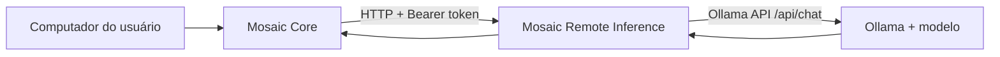

<!-- Mosaic visual identity: graphite, white and red #E3262E. -->
<div align="center">
  
  <h1>MOSAIC · REMOTE INFERENCE</h1>
  <p><strong>Modelos maiores. Um Core que continua sendo seu.</strong></p>
  <p>Serviço HTTP independente para inferência em modelos Ollama hospedados em outra máquina.</p>
  <p>
    
    
    
    
  </p>
</div>

---

## Objetivo

O **Mosaic Remote Inference (RR1)** permite que o Mosaic, executado no computador do usuário, solicite respostas a um modelo hospedado em outra máquina — por exemplo, um computador com mais memória e um modelo maior disponível no Ollama.

O serviço é separado do **Mosaic Core**. Ele recebe uma solicitação autenticada, valida seus limites, encaminha a inferência ao Ollama configurado e devolve o texto gerado. O Core continua responsável por conversas, memória, projetos, contexto e estado.

> **Princípio:** o modelo pode mudar de máquina; a continuidade do Mosaic permanece sob controle do Core.

## Arquitetura



A integração deve acontecer pelo Core, não diretamente pela interface web, para que o segredo de autenticação não seja exposto no frontend.

## Tecnologias

- **Python 3.11+** — runtime.
- **FastAPI** — API HTTP.
- **Pydantic v2** — validação de contratos.
- **httpx** — comunicação assíncrona com Ollama.
- **Uvicorn** — servidor ASGI.
- **pytest / pytest-asyncio** — testes.
- **Ollama** — runtime do modelo na máquina de inferência.

## O que existe hoje — RR1

| Componente | Situação |
|---|---|
| Aplicação FastAPI independente | Implementado |
| Autenticação Bearer token | Implementado |
| Health checks de processo e prontidão | Implementado |
| Endpoint de capacidades | Implementado |
| Inferência de texto sem streaming | Implementado |
| Adaptador Ollama via `/api/chat` | Implementado |
| Limites de entrada e parâmetros | Implementado |
| Erros públicos normalizados | Implementado |
| Testes de contrato, autenticação, configuração e health | Incluídos |
| Integração de ponta a ponta com Mosaic Core | Pendente |
| Streaming, tools, múltiplos modelos e persistência | Fora do RR1 |

O serviço usa **um modelo configurado no servidor**. O cliente não pode escolher URLs de runtime nem alterar o modelo por requisição.

## Requisitos

- Python **3.11+**
- Git
- Ollama instalado e acessível pela máquina do serviço
- Um modelo baixado no Ollama
- Um token secreto forte para autenticar o Core

## Instalação

### 1. Clone o repositório

```bash
git clone https://github.com/IGOR-SciDATA/mosaic-remote-inference.git
cd mosaic-remote-inference
```

### 2. Crie o ambiente Python

**Windows (PowerShell):**

```powershell
py -3.11 -m venv .venv
.\.venv\Scripts\Activate.ps1
pip install -r requirements.txt
Copy-Item .env.example .env
```

**Linux / macOS:**

```bash
python3 -m venv .venv
source .venv/bin/activate
pip install -r requirements.txt
cp .env.example .env
```

### 3. Configure as variáveis

Edite `.env` e defina:

```dotenv
MOSAIC_REMOTE_INFERENCE_TOKEN=seu-segredo-longo-e-aleatorio
MOSAIC_RUNTIME_BASE_URL=http://127.0.0.1:11434
MOSAIC_RUNTIME_MODEL=qwen2.5:3b
MOSAIC_INFERENCE_TIMEOUT_SECONDS=90
MOSAIC_MAX_INPUT_CHARS=24000
MOSAIC_MAX_MESSAGES=40
```

Gere um segredo com:

```bash
python -c "import secrets; print(secrets.token_urlsafe(48))"
```

A aplicação lê variáveis de ambiente, mas **não carrega o arquivo `.env` automaticamente nesta versão**. Exporte/carregue os valores no ambiente antes de iniciar o servidor. Nunca faça commit do token real.

### 4. Prepare o Ollama

Na máquina que executará o modelo:

```bash
ollama pull qwen2.5:3b
ollama list
```

O nome em `MOSAIC_RUNTIME_MODEL` deve corresponder ao nome exibido por `ollama list`. Para usar um modelo maior, baixe-o no Ollama e ajuste a variável.

Por padrão, Ollama deve estar acessível em `http://127.0.0.1:11434` na mesma máquina. Se estiver em outra máquina, configure o endereço interno correto e proteja a comunicação na rede.

### 5. Inicie o serviço

Com as variáveis já carregadas no ambiente:

```bash
uvicorn app.main:app --host 127.0.0.1 --port 8090
```

Use `--host 0.0.0.0` apenas quando o acesso pela rede estiver planejado e protegido. Não exponha o endpoint diretamente à internet pública sem TLS e controles de rede.

## Endpoints

| Método | Endpoint | Autenticação | Finalidade |
|---|---|---|---|
| `GET` | `/health/live` | Não | Confirma que o processo está ativo |
| `GET` | `/health/ready` | Não | Verifica runtime e modelo configurado |
| `GET` | `/v1/capabilities` | Não | Informa versão do protocolo e capacidades |
| `POST` | `/v1/inference` | Bearer token | Solicita geração de texto |

Exemplo:

```bash
curl http://127.0.0.1:8090/v1/inference \
  -H "Authorization: Bearer SEU_TOKEN" \
  -H "Content-Type: application/json" \
  -d '{
    "messages": [{"role": "user", "content": "Olá! Explique brevemente o Mosaic."}],
    "temperature": 0.2,
    "max_tokens": 300
  }'
```

Resposta esperada:

```json
{"model":"qwen2.5:3b","output_text":"..."}
```

## Testes

```bash
python -m pytest -q
```

Os testes usam um adaptador controlado e não exigem um Ollama real. Antes de implantar, faça também um teste de fumaça contra o runtime real.

## Segurança e limites

- Guarde o token em variáveis de ambiente ou em um gerenciador de segredos.
- Nunca exponha o token no frontend, no Git ou no corpo JSON.
- Use TLS e controles de rede quando o tráfego cruzar uma rede não confiável.
- A URL do Ollama é configuração administrativa, nunca entrada fornecida pelo cliente.
- Erros não devem expor tokens, corpos brutos do runtime ou detalhes internos.
- O serviço é stateless: não persiste conversas, memórias, projetos ou resultados.
- O serviço não executa ferramentas nem autoriza ações do Mosaic.

## Próximos passos

1. Executar os testes e validar contra Ollama real.
2. Fechar o contrato de integração com o Mosaic Core.
3. Integrar a inferência remota sem transferir memória ou estado para este serviço.
4. Considerar streaming em uma fase futura.

---

<div align="center"><sub>MOSAIC · Complexidade no Core. Simplicidade na superfície.</sub></div>
